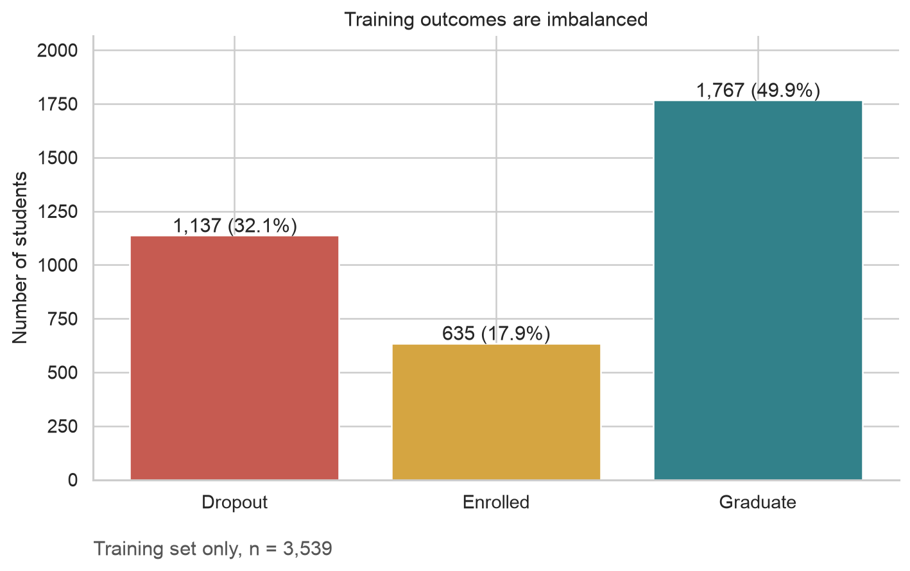
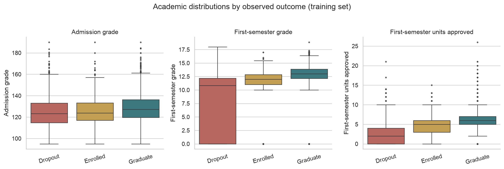
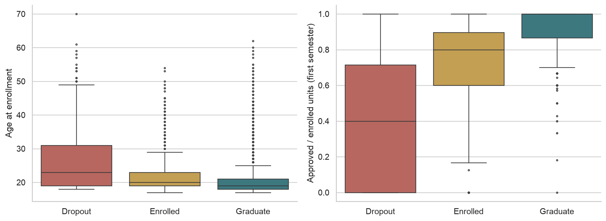
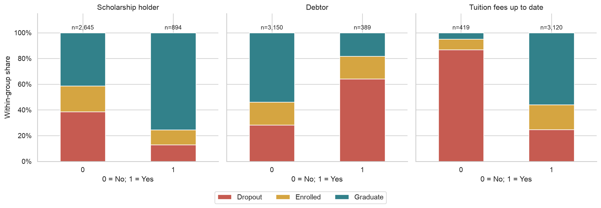
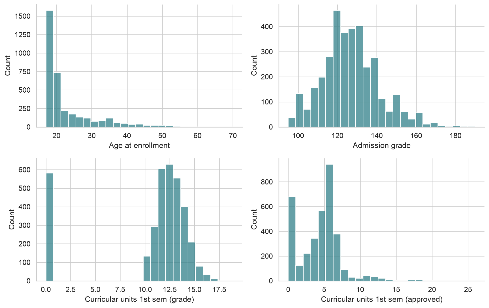
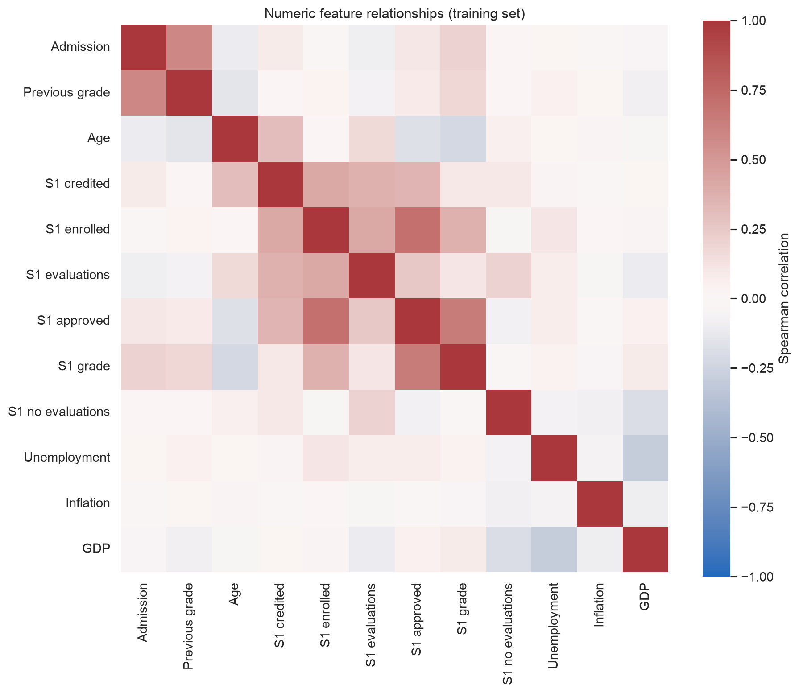

INSY 674 · PERSON B

# Exploratory Data Analysis

Predicting Students’ Dropout and Academic Success

Academic patterns, financial indicators and implications for data preparation

## 1. Purpose and analysis scope

This analysis examines the structure and quality of the student dataset, outcome imbalance, academic and financial patterns, and relationships between numeric features. It supports two modeling questions: whether first-semester academic information is useful for early prediction, and whether financial information may provide additional predictive value. EDA describes associations; comparative predictive performance remains a modeling task.

The source contains 4,424 records, 36 input features and one target. UCI defines Dropout, Enrolled and Graduate at the end of the normal course duration. Enrolled is an unresolved eventual outcome, rather than evidence of eventual graduation.

**Analysis population:** 3,539 training records from a stratified 80/20 split (random_state=42). The remaining 885 records are reserved for final testing. All charts and outcome comparisons below use training data only. This split is proposed for team adoption and must be reconciled with any existing team split.

Second-semester performance is excluded because the project focuses on admission and first-semester prediction. Administrative and financial recording dates are not established here, so timing-specific uses require verification. Dates of dropout are also unavailable; the analysis cannot verify that every student was still eligible for a first-semester-end prediction.

## 2. Data quality and missing information

No explicit blank/NaN cells were found in the eligible training fields, and there are no completely duplicated rows in the original CSV. This does not mean that every field is semantically complete: parental qualification code 34 means Unknown in the UCI dictionary.

| Field | Unknown code | Training n | Training % |
| --- | --- | --- | --- |
| Mother's qualification | 34 | 108 | 3.05 |
| Father's qualification | 34 | 93 | 2.63 |

Unknown categories should be distinguished from blank values and preserved or handled explicitly. Zero semester grades should not automatically be converted into missing values; they must be interpreted alongside assessments and approved units. Valid extreme ages and academic counts should not be removed simply because a boxplot marks them as outliers.

The attendance column contains trailing header whitespace, which the script removes. Course, nationality, occupation and qualification values are categorical codes, even though the CSV stores them as integers. Numeric distances between their codes are not meaningful.

Appendix A profiles every input field. Second-semester variables are listed as excluded without exploring their values.

## 3. Outcome distribution and class imbalance

| Status | n | Percent |
| --- | --- | --- |
| Dropout | 1137 | 32.13 |
| Enrolled | 635 | 17.94 |
| Graduate | 1767 | 49.93 |

*Figure 1. Training-set outcome distribution. Training data only.*

**Finding:** Graduate is the largest class (49.93%), while Enrolled is the smallest (17.94%). A classifier that always predicts Graduate would attain 49.93% accuracy on these training records while identifying no Dropout cases.

**Implication:** accuracy alone is insufficient. The modeling stage should use macro F1 for overall comparison and report Dropout recall and precision. This descriptive majority proportion is not a final test-set performance estimate.

## 4. Academic factors

*Figure 2. Academic measures by outcome. Training data only.*

| Target | Admission grade | Curricular units 1st sem (grade) | Curricular units 1st sem (approved) |
| --- | --- | --- | --- |
| Dropout | 123.30 | 10.83 | 2.00 |
| Enrolled | 123.90 | 12.00 | 5.00 |
| Graduate | 127.30 | 13.00 | 6.00 |

**Finding:** first-semester approved-unit medians are 2 for Dropout, 5 for Enrolled and 6 for Graduate. Semester-grade medians are 10.83, 12.00 and 13.00. Admission-grade medians are closer: 123.3, 123.9 and 127.3. The distributions overlap, so none of these measurements deterministically identifies an individual outcome.

**Implication:** first-semester progress is a promising source of additional information beyond admission records. The later modeling comparison should quantify this hypothesis using identical validation folds, rather than infer prediction accuracy from boxplots.

*Figure 3. Age and first-semester approval rate. Training data only.*

**Finding:** approval-rate distributions differ across outcomes, and ages overlap despite differences in their distributions. Approved units divided by enrolled units is a candidate measure of academic progress. There are 148 training records with a zero denominator; the script leaves the ratio undefined in that case.

**Implication:** any production version of this feature needs an explicit zero-denominator policy inside the preprocessing pipeline. Age is a background variable, not an individual decision rule.

## 5. Financial indicators

*Figure 4. Within-group outcome shares for financial indicators. Training data only.*

| Indicator | 0=No / 1=Yes | Group n | Dropout n | Dropout % | 95% CI lower | 95% CI upper |
| --- | --- | --- | --- | --- | --- | --- |
| Scholarship holder | 0 | 2645 | 1022 | 38.64 | 36.80 | 40.51 |
| Scholarship holder | 1 | 894 | 115 | 12.86 | 10.83 | 15.22 |
| Debtor | 0 | 3150 | 888 | 28.19 | 26.65 | 29.79 |
| Debtor | 1 | 389 | 249 | 64.01 | 59.12 | 68.62 |
| Tuition fees up to date | 0 | 419 | 364 | 86.87 | 83.30 | 89.77 |
| Tuition fees up to date | 1 | 3120 | 773 | 24.78 | 23.29 | 26.32 |

**Finding:** the observed dropout share is 86.87% when tuition is not up to date, compared with 24.78% when it is up to date. Debtors have a 64.01% share, versus 28.19% for non-debtors. Scholarship holders have a 12.86% share, versus 38.64% for non-holders.

**Interpretation:** these within-group percentages show associations without confusing group size with risk. Sample counts and descriptive 95% Wilson intervals indicate uncertainty; intervals do not account for confounding or multiple exploratory comparisons. Financial recording times and overlap with academic information still require examination. These results neither show that financial difficulties cause dropout nor demonstrate that aid would prevent it.

## 6. Numeric distributions and feature relationships

*Figure 5. Selected numeric feature distributions. Training data only.*

**Finding:** age has a right tail, admission grades are concentrated near the middle of their range, and first-semester performance has a visible concentration at zero. These shapes argue against assuming that all numeric variables are normally distributed.

**Implication:** scaling may be useful for linear or distance-based models; transformations should be justified and fitted inside training folds. Zero-valued academic performance should be examined rather than automatically imputed.

*Figure 6. Spearman correlations among eligible numeric features. Training data only.*

| feature_1 | feature_2 | rho |
| --- | --- | --- |
| Curricular units 1st sem (enrolled) | Curricular units 1st sem (approved) | 0.71 |
| Curricular units 1st sem (approved) | Curricular units 1st sem (grade) | 0.64 |
| Admission grade | Previous qualification (grade) | 0.58 |
| Curricular units 1st sem (credited) | Curricular units 1st sem (enrolled) | 0.42 |
| Curricular units 1st sem (enrolled) | Curricular units 1st sem (evaluations) | 0.42 |

**Finding:** enrolled and approved units have a Spearman correlation of approximately 0.708; approved units and semester grades correlate at approximately 0.644. These academic measurements contain overlapping information.

**Implication:** correlated features can share model importance, making individual rankings unstable. The academic-versus-financial question should be tested through feature-group comparisons. Nominal category codes and Target are excluded from this numeric correlation matrix. Course-level counts and dropout shares are exported by the script; small groups warrant caution, and course codes have no ordinal meaning.

## 7. Preparation recommendations

- Encode nominal categories and explicitly handle unknown codes; preserve the unchanged raw data.

- Consider first-semester approval rate, with a defined zero-denominator policy. Retain valid extremes unless a documented data error justifies removal.

- Fit all preprocessing within training/CV folds. Keep the final test set out of feature selection and transformation decisions.

- Exclude second-semester features from both early-prediction scenarios. Confirm timing of scholarship, debtor and tuition-payment status before assigning them to a prediction scenario.

- Compare Context, Context + Academic, Context + Financial and Context + Academic + Financial under the same model and validation settings. Treat macroeconomic conditions and demographic variables consistently as context.

## 8. Limitations and useful additional data

This observational dataset supports descriptive and predictive research rather than causal claims. Random splitting provides an internal comparison and does not establish future-cohort or cross-university generalization. Financial timestamps, dropout dates and cohort identifiers would strengthen temporal validation. Household income, aid amounts, attendance and support-service usage could enrich the analysis but are not supplied in this CSV. Outcomes of interventions would be necessary to evaluate whether a warning system actually improves retention.

## 9. Summary

The training data show outcome imbalance and distinct academic and financial patterns worth testing. First-semester progress appears informative descriptively, while financial indicators also show large group differences. Whether either feature group provides stronger or additional predictive value must be evaluated by the modeling team. The main EDA contributions are documented data quality, complete feature profiling, interpretable visual findings and concrete preparation recommendations.

## Reference and reproducibility

Realinho, V., Vieira Martins, M., Machado, J., & Baptista, L. (2021). *Predict Students’ Dropout and Academic Success* [Dataset]. UCI Machine Learning Repository. [doi:10.24432/C5MC89](https://doi.org/10.24432/C5MC89). Data license: CC BY 4.0.

Variable definitions and label horizon: [UCI dataset documentation](https://archive.ics.uci.edu/dataset/697/predict+students+dropout+and+academic+success).

Run the accompanying script with the original CSV: `python Person_B_EDA_Script.py --data /path/to/data.csv`. Install dependencies with `python -m pip install pandas numpy matplotlib seaborn scikit-learn`. Python 3.13 was used for verification. The script regenerates figures, detailed tables, split assignments and an analytical Markdown report in `person_b_eda_results/`. This Markdown report references images in the accompanying `eda_figures/` folder. Upload both the report and that folder to GitHub, preserving their relative paths.

## Appendix A. Complete feature profile

All percentages and distributions below use training records. Excluded second-semester variables are documented without value-level exploration. Enrollment candidates require confirmation where recording times are uncertain. Descriptive skew is a sample statistic, not a formal distributional test.

| Feature | Group | Type | Time scope | Missing % | Unique values | Distribution | Preparation notes |
| --- | --- | --- | --- | --- | --- | --- | --- |
| Marital status | Context | Categorical code | Enrollment candidate; verify administrative timing | 0.0 | 6 | Category frequencies in categorical_counts.csv | Do not interpret numeric codes as continuous. |
| Application mode | Context | Categorical code | Enrollment candidate; verify administrative timing | 0.0 | 18 | Category frequencies in categorical_counts.csv | Do not interpret numeric codes as continuous. |
| Application order | Context | Numeric/ordinal | Enrollment candidate; verify administrative timing | 0.0 | 8 | min=0; median=1; max=9; skew=1.88 | Inspect skew and extremes; retain valid observations. |
| Course | Context | Categorical code | Enrollment candidate; verify administrative timing | 0.0 | 17 | Category frequencies in categorical_counts.csv | Do not interpret numeric codes as continuous. |
| Daytime/evening attendance | Context | Categorical code | Enrollment candidate; verify administrative timing | 0.0 | 2 | Category frequencies in categorical_counts.csv | Do not interpret numeric codes as continuous. |
| Previous qualification | Academic | Categorical code | Enrollment candidate; verify administrative timing | 0.0 | 17 | Category frequencies in categorical_counts.csv | Do not interpret numeric codes as continuous. |
| Previous qualification (grade) | Academic | Numeric/ordinal | Enrollment candidate; verify administrative timing | 0.0 | 99 | min=95; median=133; max=190; skew=0.33 | Inspect skew and extremes; retain valid observations. |
| Nacionality | Context | Categorical code | Enrollment candidate; verify administrative timing | 0.0 | 19 | Category frequencies in categorical_counts.csv | Do not interpret numeric codes as continuous. |
| Mother's qualification | Context | Categorical code | Enrollment candidate; verify administrative timing | 0.0 | 28 | Category frequencies in categorical_counts.csv | Do not interpret numeric codes as continuous. Unknown code 34: 108 (3.1%). |
| Father's qualification | Context | Categorical code | Enrollment candidate; verify administrative timing | 0.0 | 32 | Category frequencies in categorical_counts.csv | Do not interpret numeric codes as continuous. Unknown code 34: 93 (2.6%). |
| Mother's occupation | Context | Categorical code | Enrollment candidate; verify administrative timing | 0.0 | 31 | Category frequencies in categorical_counts.csv | Do not interpret numeric codes as continuous. |
| Father's occupation | Context | Categorical code | Enrollment candidate; verify administrative timing | 0.0 | 41 | Category frequencies in categorical_counts.csv | Do not interpret numeric codes as continuous. |
| Admission grade | Academic | Numeric/ordinal | Enrollment candidate; verify administrative timing | 0.0 | 591 | min=95; median=126; max=190; skew=0.55 | Inspect skew and extremes; retain valid observations. |
| Displaced | Context | Categorical code | Enrollment candidate; verify administrative timing | 0.0 | 2 | Category frequencies in categorical_counts.csv | Do not interpret numeric codes as continuous. |
| Educational special needs | Context | Categorical code | Enrollment candidate; verify administrative timing | 0.0 | 2 | Category frequencies in categorical_counts.csv | Do not interpret numeric codes as continuous. |
| Debtor | Financial | Categorical code | Enrollment candidate; verify administrative timing | 0.0 | 2 | Category frequencies in categorical_counts.csv | Do not interpret numeric codes as continuous. Recording date unconfirmed; early-availability assumption must be documented. |
| Tuition fees up to date | Financial | Categorical code | Enrollment candidate; verify administrative timing | 0.0 | 2 | Category frequencies in categorical_counts.csv | Do not interpret numeric codes as continuous. Recording date unconfirmed; early-availability assumption must be documented. |
| Gender | Context | Categorical code | Enrollment candidate; verify administrative timing | 0.0 | 2 | Category frequencies in categorical_counts.csv | Do not interpret numeric codes as continuous. |
| Scholarship holder | Financial | Categorical code | Enrollment candidate; verify administrative timing | 0.0 | 2 | Category frequencies in categorical_counts.csv | Do not interpret numeric codes as continuous. Recording date unconfirmed; early-availability assumption must be documented. |
| Age at enrollment | Context | Numeric/ordinal | Enrollment candidate; verify administrative timing | 0.0 | 46 | min=17; median=20; max=70; skew=2.05 | Inspect skew and extremes; retain valid observations. |
| International | Context | Categorical code | Enrollment candidate; verify administrative timing | 0.0 | 2 | Category frequencies in categorical_counts.csv | Do not interpret numeric codes as continuous. |
| Curricular units 1st sem (credited) | Academic | Count | End of first semester | 0.0 | 21 | min=0; median=0; max=20; skew=4.20 | Inspect skew and extremes; retain valid observations. |
| Curricular units 1st sem (enrolled) | Academic | Count | End of first semester | 0.0 | 23 | min=0; median=6; max=26; skew=1.65 | Inspect skew and extremes; retain valid observations. |
| Curricular units 1st sem (evaluations) | Academic | Count | End of first semester | 0.0 | 35 | min=0; median=8; max=45; skew=0.90 | Inspect skew and extremes; retain valid observations. |
| Curricular units 1st sem (approved) | Academic | Count | End of first semester | 0.0 | 23 | min=0; median=5; max=26; skew=0.78 | Inspect skew and extremes; retain valid observations. |
| Curricular units 1st sem (grade) | Academic | Count | End of first semester | 0.0 | 683 | min=0; median=12.3; max=18.9; skew=-1.55 | Inspect skew and extremes; retain valid observations. Zero grade may indicate no successful assessment; do not replace with missing automatically. |
| Curricular units 1st sem (without evaluations) | Academic | Count | End of first semester | 0.0 | 11 | min=0; median=0; max=12; skew=7.60 | Inspect skew and extremes; retain valid observations. |
| Curricular units 2nd sem (credited) | Context | Count | Excluded: after prediction horizon | not analyzed | not analyzed | Excluded | Excluded from both scenarios. |
| Curricular units 2nd sem (enrolled) | Context | Count | Excluded: after prediction horizon | not analyzed | not analyzed | Excluded | Excluded from both scenarios. |
| Curricular units 2nd sem (evaluations) | Context | Count | Excluded: after prediction horizon | not analyzed | not analyzed | Excluded | Excluded from both scenarios. |
| Curricular units 2nd sem (approved) | Context | Count | Excluded: after prediction horizon | not analyzed | not analyzed | Excluded | Excluded from both scenarios. |
| Curricular units 2nd sem (grade) | Context | Count | Excluded: after prediction horizon | not analyzed | not analyzed | Excluded | Excluded from both scenarios. |
| Curricular units 2nd sem (without evaluations) | Context | Count | Excluded: after prediction horizon | not analyzed | not analyzed | Excluded | Excluded from both scenarios. |
| Unemployment rate | Context | Numeric/ordinal | Enrollment candidate; verify administrative timing | 0.0 | 10 | min=7.6; median=11.1; max=16.2; skew=0.21 | Inspect skew and extremes; retain valid observations. |
| Inflation rate | Context | Numeric/ordinal | Enrollment candidate; verify administrative timing | 0.0 | 9 | min=-0.8; median=1.4; max=3.7; skew=0.27 | Inspect skew and extremes; retain valid observations. |
| GDP | Context | Numeric/ordinal | Enrollment candidate; verify administrative timing | 0.0 | 10 | min=-4.06; median=0.32; max=3.51; skew=-0.39 | Inspect skew and extremes; retain valid observations. |
