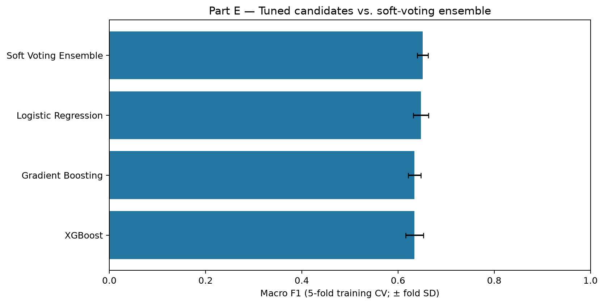
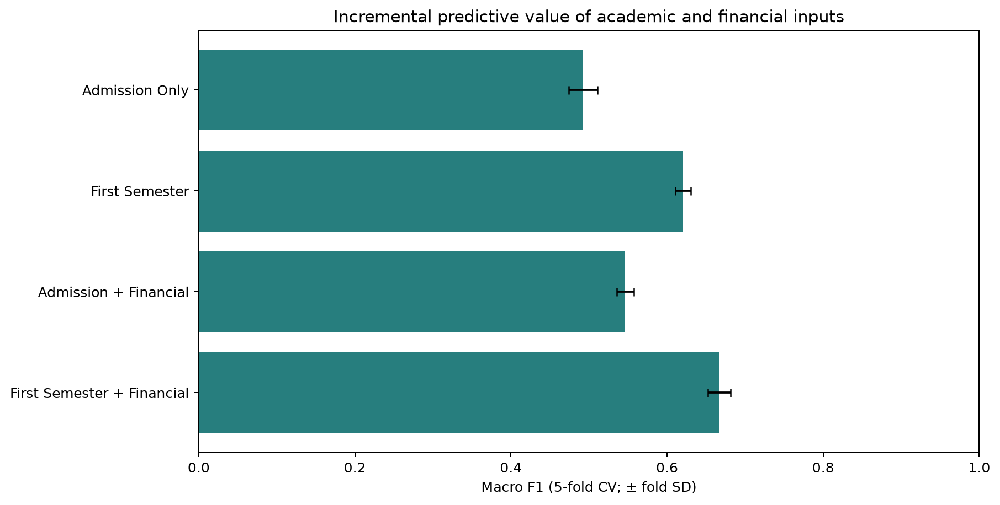
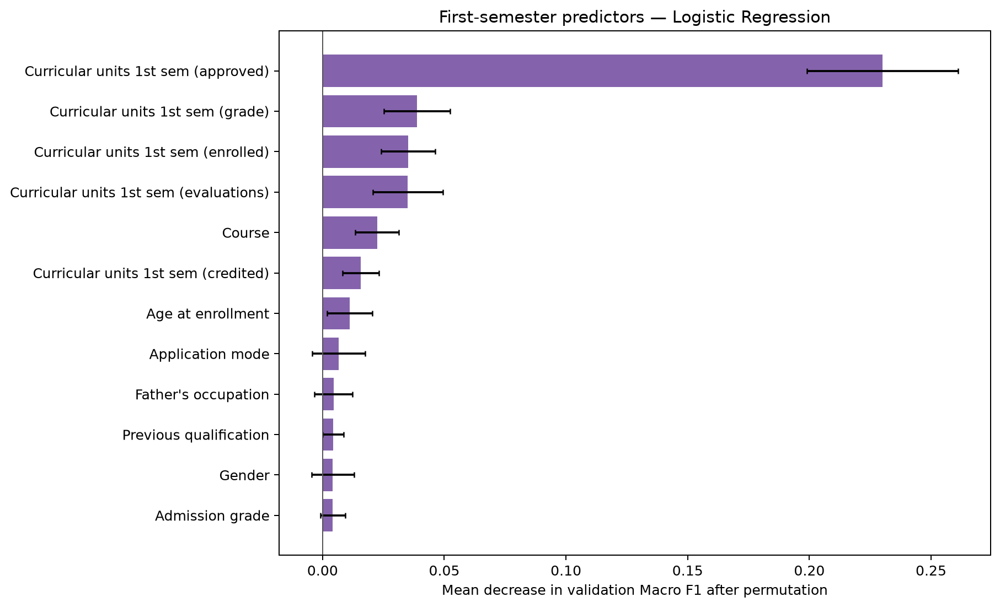
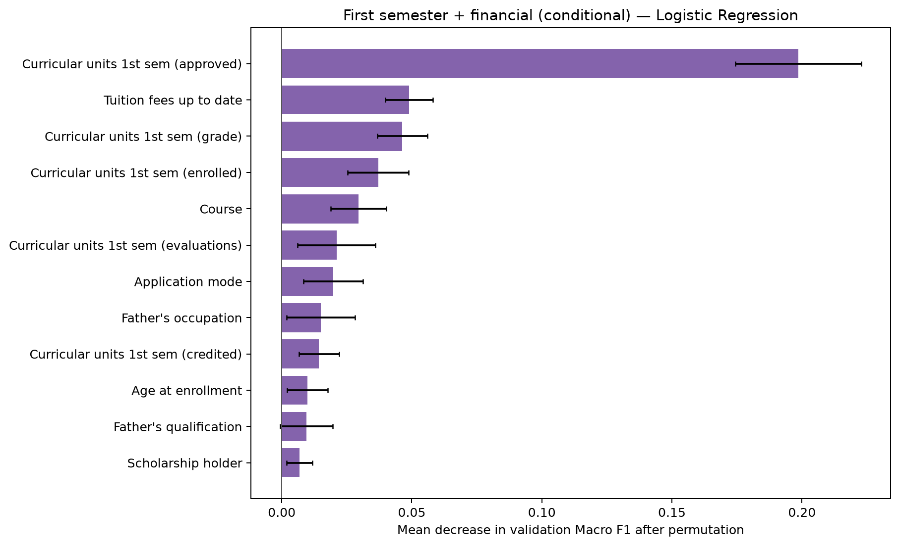

# Part E — Hyperparameter Tuning and Feature Importance

## Objective and reproducibility
We build on Person D's stratified 80/20 split (seed 42), 5-fold stratified CV, and four predeclared feature sets. Only training rows are used in this part. We compare models by macro F1, with dropout recall as an operational secondary metric. The final test set is reserved for Person F.

## Hyperparameter tuning (First Semester, no financial indicators)
We applied RandomizedSearchCV with five stratified folds to the three models shortlisted by D: XGBoost, Gradient Boosting, and Logistic Regression. Search spaces addressed model complexity, learning rate, regularization, and (for logistic regression) class weighting. This is a randomized search of a bounded hyperparameter space, not an exhaustive optimization or a causal experiment.

| Model               |   CV Macro F1 Mean |   CV Macro F1 Std |   Train - CV Gap |
|:--------------------|-------------------:|------------------:|-----------------:|
| Logistic Regression |             0.6476 |            0.0158 |           0.0292 |
| Gradient Boosting   |             0.6344 |            0.0135 |           0.1455 |
| XGBoost             |             0.6342 |            0.0184 |           0.1671 |

Figure: 

## Soft-voting ensemble and model selection
A three-model soft-voting ensemble was compared with each tuned model using the same first-semester inputs and five-fold CV.

| Candidate            |   Macro F1 Mean |   Macro F1 Std |   Dropout Recall Mean |   Dropout Recall Std |   Accuracy Mean |
|:---------------------|----------------:|---------------:|----------------------:|---------------------:|----------------:|
| Soft Voting Ensemble |          0.6516 |         0.0113 |                0.6939 |               0.0248 |          0.7304 |
| Logistic Regression  |          0.6476 |         0.0158 |                0.6429 |               0.0221 |          0.6948 |
| Gradient Boosting    |          0.6344 |         0.0135 |                0.7053 |               0.0182 |          0.7259 |
| XGBoost              |          0.6342 |         0.0184 |                0.708  |               0.0187 |          0.7268 |

**Provisional training-CV choice:** Soft Voting Ensemble. These cross-validation results help with selection but may be optimistic because the same training data informs tuning and selection. Person F must evaluate the locked model once on the untouched held-out test set. No final-test performance claim is made here.

## Incremental academic and financial information
To hold modeling conditions constant, we compared all four feature sets using the same untuned Logistic Regression estimator and the same five stratified folds:

| Feature Set                |   Raw Feature Count |   Macro F1 Mean |   Macro F1 Std |   Dropout Recall Mean |
|:---------------------------|--------------------:|----------------:|---------------:|----------------------:|
| Admission Only             |                  18 |          0.4924 |         0.0182 |                0.5294 |
| First Semester             |                  24 |          0.6206 |         0.0099 |                0.6966 |
| Admission + Financial      |                  21 |          0.5464 |         0.011  |                0.598  |
| First Semester + Financial |                  27 |          0.6669 |         0.0148 |                0.7511 |

- Adding first-semester academic results to admission context: Δ macro F1 = **+0.1282**.
- Adding financial variables to admission context: Δ macro F1 = **+0.0540** (conditional on verified timing).
- Adding financial variables to first-semester context: Δ macro F1 = **+0.0463** (conditional on verified timing).

This is a comparison of predictive contributions under a fixed-model CV setup. The admission group already includes some academic-background attributes, so the academic delta specifically measures **added first-semester observations**. The financial fields (scholarship, debtor, tuition-payment status) have unverified recording times. Do not interpret these associations as causal effects or proven deployable early-warning inputs.

## Feature importance
For interpretability we computed permutation importance on training-held-out CV folds using the best tuned single model (Logistic Regression) and reported the reduction in validation macro F1 when an original column was shuffled. The top eight columns were: **Curricular units 1st sem (approved), Curricular units 1st sem (grade), Curricular units 1st sem (enrolled), Curricular units 1st sem (evaluations), Course, Curricular units 1st sem (credited), Age at enrollment, Application mode**.

A separate conditional model using First Semester + Financial was interpreted to examine the three finance-related columns:

| Feature                 |   Mean |    Std |
|:------------------------|-------:|-------:|
| Tuition fees up to date | 0.049  | 0.0091 |
| Scholarship holder      | 0.0069 | 0.005  |
| Debtor                  | 0.0044 | 0.0044 |

Permutation importance is model-specific and may distribute importance across correlated inputs; it does not imply causality or justify an individual-level intervention by itself.

## Limitations and next step for Person F
- Hyperparameter selection and model comparison reuse the training folds; reported CV results are exploratory model-selection metrics and potentially optimistic.
- The Enrolled label does not settle students' eventual outcomes. Its class-specific performance should be explicitly reported by F.
- Financial administrative timestamps are unverified. The **main** selected first-semester modeling scenario intentionally excludes the financial variables.
- No held-out test scores were calculated in E. F should take the frozen selection from `model_selection_for_F.json`, reproduce the training pipeline, evaluate once, and discuss confusion matrices, recall/F1, and realistic limitations.
- Before finalizing, A/E should verify all rubric items and ensure the repository contains final documentation and evidence figures.
