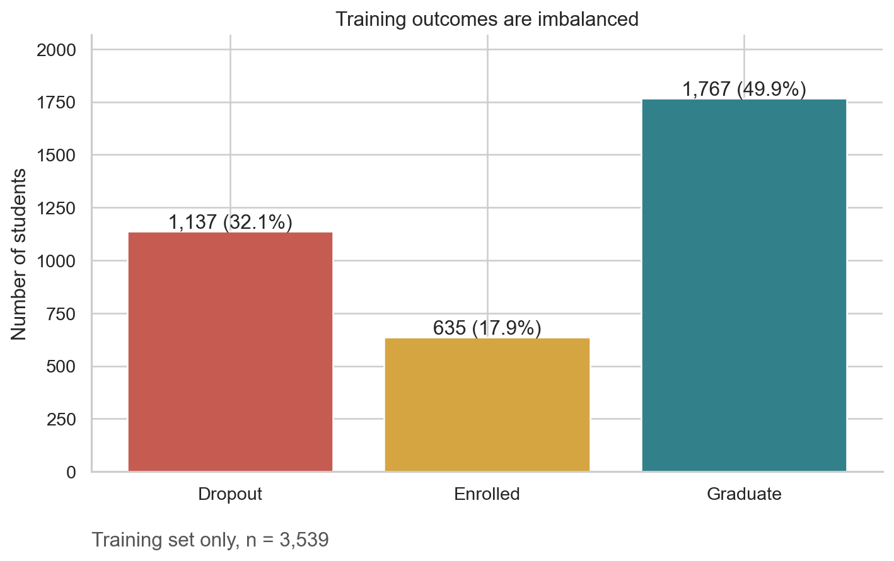
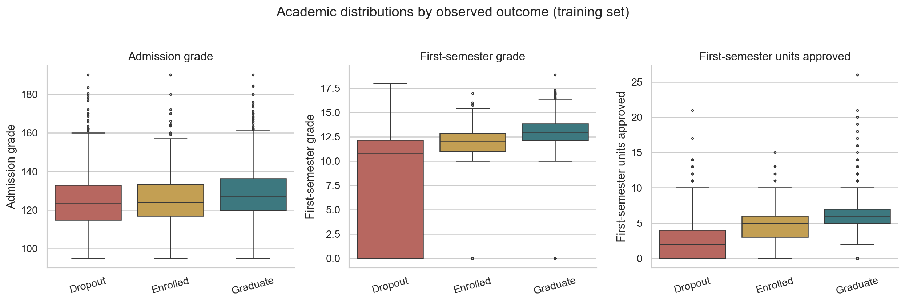
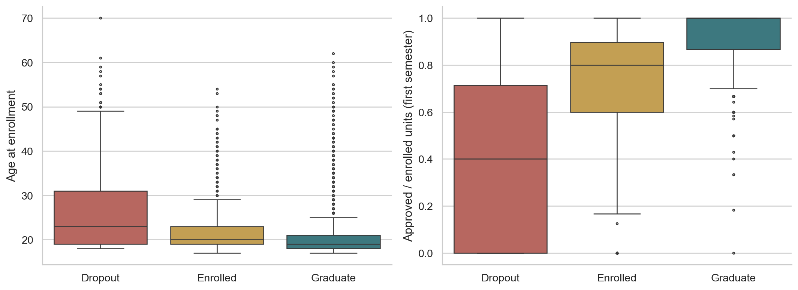
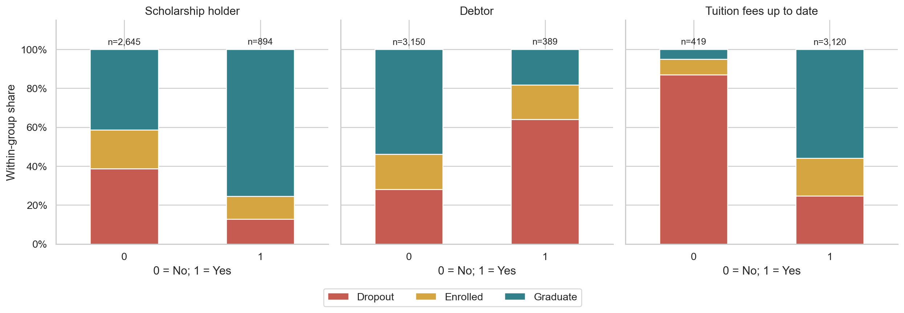
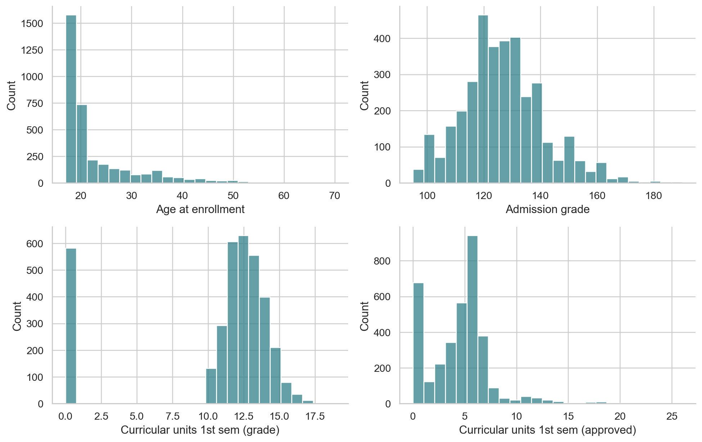
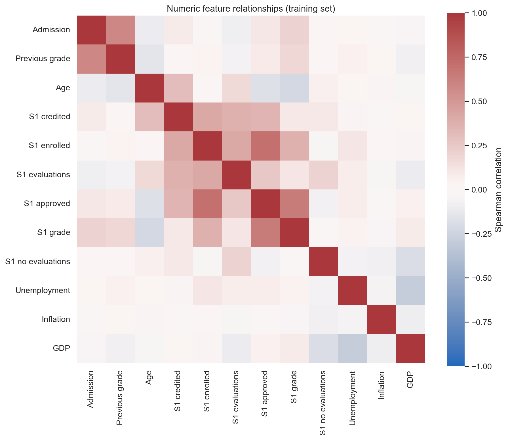

# Person B: Exploratory Data Analysis Report

## 1. Purpose and research alignment
This EDA examines outcome imbalance, academic patterns, financial indicators and data quality. It supports the team's questions about early prediction and the incremental predictive value of academic and financial information. It does not train a classifier or rank feature groups by predictive performance.

## 2. Source, scope and reproducibility
The UCI dataset contains 4,424 student records, 36 input variables and Target. The three labels describe status at the end of the normal course duration. Enrolled is an unresolved eventual outcome, not a guarantee of future graduation.

A stratified 80%/20% split with random_state=42 assigns **3,539 records to training and 885 to held-out testing**. All outcome-related figures and summaries below use training records only. No held-out performance is calculated. The input file structure and full-row duplicates are checked globally; these checks do not select predictors. `tables/split_assignments.csv` stores the shared row assignment and `run_metadata.json` records the source hash. The team must adopt this split, or regenerate this EDA with the team's agreed split before modeling.

Six second-semester fields are excluded from substantive exploration. The first-semester scenario includes earlier information plus six first-semester measurements. Availability dates of financial and administrative information remain unverified: results involving these fields are descriptive, conditional on later confirming availability.

## 3. Outcome distribution
| Status | n | Percent |
|---|---|---|
| Dropout | 1137 | 32.13 |
| Enrolled | 635 | 17.94 |
| Graduate | 1767 | 49.93 |

**Takeaway:** class frequencies differ. An always-Graduate classifier would have training accuracy of 49.9%, without identifying any Dropout cases. This is a descriptive baseline, not a held-out model result. D should prioritize macro F1 and class-specific dropout recall/precision over accuracy alone.

## 4. Data quality and complete attribute profiling
No literal missing cells were found in the eligible training fields. The full CSV contains 0 completely duplicated rows. These checks do not prove every value is valid or semantically complete. Parent qualification code 34 denotes Unknown in UCI documentation; preserve that distinction from a blank value. Other codes must be checked against the complete dictionary rather than assumed ordinal.

`tables/attribute_profile.csv` covers all 36 features: semantic type, feature group, time scope, missingness, cardinality, numeric range/skew or frequency-table reference, and preparation notes. Second-semester features are documented as excluded rather than having their values explored. Detailed category frequencies and numeric summaries accompany the profile.

The source header contains trailing whitespace in Daytime/evening attendance; the script strips header whitespace. Numeric codes for course, nationality, occupations and qualifications represent categories. Avoid Pearson correlations or continuous scaling of these codes as if the numeric distances were meaningful. Valid extreme ages or academic counts should not be dropped solely because they are boxplot outliers.

## 5. Academic factors

Training-group medians:
| Target | Admission grade | Curricular units 1st sem (grade) | Curricular units 1st sem (approved) |
|---|---|---|---|
| Dropout | 123.3 | 10.83 | 2.0 |
| Enrolled | 123.9 | 12.0 | 5.0 |
| Graduate | 127.3 | 13.0 | 6.0 |

**Takeaway:** compare the group medians and overlapping distributions rather than treating a single low grade as a deterministic rule. First-semester grade and passed-unit counts show the academic separation visible in the figure; admission grade provides an earlier comparison. These are associations, with predictive value to be measured in CV by D/E.

**Takeaway:** approved/enrolled units is a candidate academic progress feature. 148 training records have zero enrolled units and therefore an undefined ratio; keep them explicit and let C handle them inside the model pipeline. Zero semester grades should not automatically become missing values, because they may reflect no successful assessments. Age distributions overlap across outcomes, so age alone is not an individual risk decision rule.

## 6. Financial indicators

- **Scholarship holder:** dropout share is 38.6% for No (n=2,645) and 12.9% for Yes (n=894).
- **Debtor:** dropout share is 28.2% for No (n=3,150) and 64.0% for Yes (n=389).
- **Tuition fees up to date:** dropout share is 86.9% for No (n=419) and 24.8% for Yes (n=3,120).

**Takeaway:** these are within-group outcome percentages, with sample counts shown to avoid confusing larger groups with higher risk. `financial_dropout_rates.csv` includes descriptive 95% Wilson intervals for dropout shares. Small groups are less precise. Financial status may be related to academic performance, background and recording time. These comparisons do not establish causality, independently adjusted effects or which support intervention would work.

## 7. Distributions, context and correlations

**Takeaway:** inspect the actual shapes, zero concentrations and tails before choosing transformations. Robust scaling or standardization may help linear/distance-based models, but fit transformations inside training folds. Do not assume normality or remove tail observations automatically.

The strongest absolute numeric-feature correlations are:
| feature_1 | feature_2 | rho |
|---|---|---|
| Curricular units 1st sem (enrolled) | Curricular units 1st sem (approved) | 0.708 |
| Curricular units 1st sem (approved) | Curricular units 1st sem (grade) | 0.644 |
| Admission grade | Previous qualification (grade) | 0.583 |
| Curricular units 1st sem (credited) | Curricular units 1st sem (enrolled) | 0.42 |
| Curricular units 1st sem (enrolled) | Curricular units 1st sem (evaluations) | 0.419 |

**Takeaway:** related academic measurements can carry overlapping information; individual feature importance may be shared across correlated predictors. Spearman correlation is descriptive and does not establish causality. Nominal category codes and Target are excluded from this numeric matrix. Course-level sample sizes and dropout shares are exported in `course_dropout_rates.csv`; rare courses require caution and numeric course codes have no ordered meaning.

## 8. Recommendations for C, D and E
- C: retain raw data; encode nominal categories; document unknown codes; construct approval rate with an explicit zero-denominator policy. Fit imputation, scaling and encoding within CV folds. Feature selection must not use the held-out test set.
- A/C: finalize a timing dictionary. Exclude second-semester features and qualify enrollment-only claims for variables with uncertain recording dates.
- D: use the shared split and identical stratified CV folds; include a majority dummy classifier and interpretable logistic regression. Report macro F1 mean/std and dropout precision/recall.
- E: compare Context, Context + Academic, Context + Financial, and Context + Academic + Financial using the same model and CV conditions. Academic-only vs financial-only importance plots cannot establish incremental value by themselves. Define Course and family background consistently as context; GDP/inflation/unemployment are macroeconomic context, not direct student finances.
- F: reserve test evaluation until model choices are fixed; discuss uncertain administrative timing, observational associations, unresolved Enrolled outcomes and transportability to other institutions.

## 9. Assumptions, limitations and useful additional data
This is descriptive analysis of a historical institutional dataset. The random split estimates an internal comparison; it does not demonstrate future-cohort or cross-university generalization. Date-stamped administrative records, cohort identifiers and dropout dates would help validate temporal availability and prevent including students whose dropout preceded an intended semester-end prediction. Household income, aid amounts, attendance, support-service usage and intervention outcomes would improve understanding but are not in this CSV. Do not infer that changing a correlated feature will change outcomes.

## 10. Conclusion
Academic and financial indicators provide testable hypotheses for the modeling team. The EDA establishes data structure, imbalance, descriptive group differences and preparation needs. Whether one group predicts better, or adds value to the other, remains a cross-validated modeling question.

## Reference
Realinho, V., Vieira Martins, M., Machado, J., & Baptista, L. (2021). *Predict Students’ Dropout and Academic Success* [Dataset]. UCI Machine Learning Repository. https://doi.org/10.24432/C5MC89. Dataset licensed CC BY 4.0. Variable meanings and label horizon: https://archive.ics.uci.edu/dataset/697/predict+students+dropout+and+academic+success.
